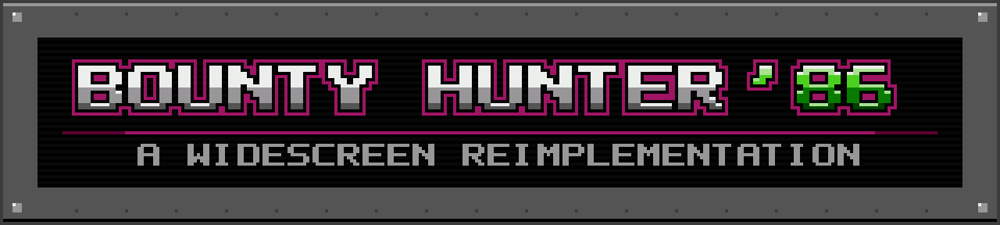

A reimplementation of a classic action-exploration game featuring a lone adventurer on a hostile alien planet.

Bounty Hunter '86 (`hunter86`) is a widescreen remaster for PC of Metroid, the 1986 NES game. It plays your own copy of the game: it contains
none of the original's code, art, music or data, and reads everything it needs from a ROM file you provide. Underneath, it plays like the NES
version; on top, there's widescreen, saving anywhere, a map and a modern pause screen, all optional.

> Not affiliated with or endorsed by Nintendo. Metroid is a trademark of Nintendo.

For now this repository holds the game's releases; the source code will follow.

## Features

- **Widescreen**: the world carries on past the old 4:3 edges, and plays the same at any width.
- **Save anywhere**, in three save slots. No passwords.
- **A full pause screen**: an automatic map, your status and gear, and every option.
- **A minimap** in the corner, colored by area.
- **Smooth at any refresh rate** (60, 120, 144 Hz or variable), with an optional smooth camera.
- **A living world**: textured backgrounds with parallax and animated lava, all optional.
- **New Game+ and Hard mode**, with your completion stats after the credits.
- **Gamepads**: Xbox, PlayStation, Switch and most others, with remappable buttons and keys.
- **Fixes** for bugs in the original (sprite flicker, a frame that went blank, a possible freeze), and the sound effects no longer cut out the music.
- **Presets**: VANILLA plays like the original, ENHANCED (the default) turns everything on, and CUSTOM is your own mix.
- **Cheats**: infinite energy and missiles, all beams and suit upgrades, the full map, one-hit kills, playing out of the suit and more, kept with each save.

## What you need

- Your own ROM file of **Metroid (USA)**, a `.nes` file. Other releases (Japan, Europe) and modified ROMs are not accepted.
- Windows 10 or 11 (64-bit), or Linux on x86-64 (Ubuntu 22.04 or later, the Steam Deck and other recent distributions).

## Getting started

Download the latest build from the [Releases](../../releases) page:

| System | Download |
|---|---|
| Windows | `hunter86-VERSION-windows-x64.zip` |
| Linux and Steam Deck | `hunter86-VERSION-linux-x86_64.tar.gz` |

**Windows:** unzip the folder, put your `.nes` file next to `hunter86.exe`, and run `hunter86.exe`. The build is not signed, so Windows may
warn you the first time: choose **More info**, then **Run anyway**.

**Linux:** unpack the archive, put your `.nes` file next to `hunter86`, and run `./hunter86`.

**Steam Deck:** in Desktop Mode, unpack the archive and put your `.nes` file next to `hunter86`. Then add `hunter86` to Steam as a non-Steam
game (Steam > Games > Add a Non-Steam Game) and play it from Game Mode.

If the game can't find your ROM, it opens a small window: drag the `.nes` file onto it. The game remembers where your ROM is after that.

## Controls

| Keyboard | Gamepad | Does |
|---|---|---|
| Arrow keys | D-pad or left stick | Move |
| Z | Bottom face button (A on Xbox) | Shoot, lay a bomb; confirm in menus |
| X | Right face button (B on Xbox) | Jump; back in menus |
| Right Shift | View / Back (Create on PlayStation, Minus on Switch) | Arm missiles |
| Enter | Menu / Start (Options on PlayStation, Plus on Switch) | Pause |
| Q / W | LB / RB (L1 / R1, L / R) | Turn the pause screen's pages |
| F11 or Alt+Enter | | Fullscreen |

The face buttons go by where they are, so the layout is the same on Xbox, PlayStation and Switch pads; on the keyboard Z and X sit in the same order as the NES pad's B and A. Every key and button can be changed on the pause screen's OPTIONS > CONTROLS page. Saving and quitting are on the pause screen too.

## Saves and settings

Some settings are your own set-up and apply to every save; the others decide how a game plays, and each save slot keeps its own:

| Kept | Pages | What that means |
|---|---|---|
| For every save | VIDEO, AUDIO, CONTROLS | Your screen, sound and buttons, the same in every slot. |
| With each save slot | PRESET, GAME, EXTRAS, CHEATS | How that game plays. The title screen's OPTIONS sets them for new games; CHEATS is in a game's pause screen. |

PRESET sets the GAME and EXTRAS options at once (VANILLA, ENHANCED or your CUSTOM mix); it leaves VIDEO alone. A cheat works only while it
is on: switch it off and you have exactly what you found.

Saves from earlier versions load as they were. Once saved with this version, they can't be read by an earlier one.

Where the files are:

| System | Folder |
|---|---|
| Windows | `%APPDATA%\hunter86` |
| Linux and Steam Deck | `~/.local/share/hunter86` |

## Command line

Run `hunter86 --help` for the full list. For example: `--windowed`, `--no-widescreen`, `--mute`, `--rom PATH`.
